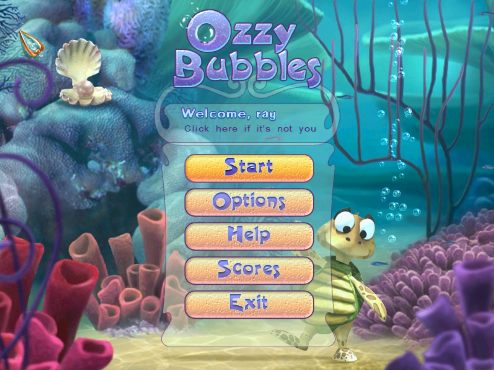
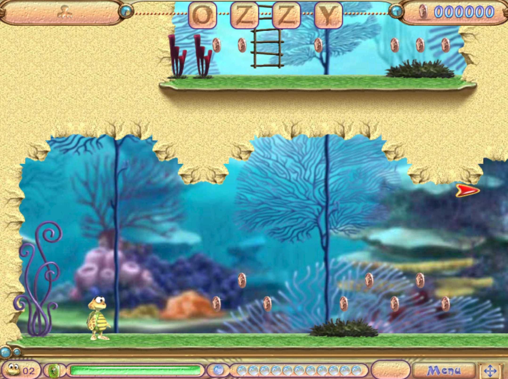

## Ozzy Bubbles Web

**Play here:** https://light-and-ray.github.io/ozzy-bubbles-web/ \
Requires WebGPU - you may need to turn it on in `chrome://flags`

### Description

Ozzy Bubbles is an unknown underrated 2D platformer from early 2000, about Ozzy the Turtle. It is an abandonware, you can't buy it anywhere, even thought bigfishgames offers this game - the site is broken, and after the purchase, it's not possible to download it. The web version is an ideal solution for people, who are afraid of launching .exe files from third party sites, but wants to revisit the game from childhood

</img> </img>

I tried to do this. It's a version converted with [bottleship](https://bottleship.pages.dev/). It works, but it lags very much, and requires WebGPU. I will try to find better versions, but for just playing on PC 1 time this can be enough

### Self hosting & launching other games

To host by yourself, clone the repo, and host `ozzy-bubbles` as a static directory. The easiest way is to run `python -m http.server` inside `ozzy-bubbles` directory, and then open `http://127.0.0.1:8000`

If you want to wrap your own game in the same crunchy manner, you can:
- pack an .exe/.msi installer into .zip file
- use this page to convert it into .wgb file: https://bottleship.pages.dev/
- replace `app-ozzy-bubbles.wgb` in this repo with this file
- modify `games-catalog.json`, replace `app-ozzy-bubbles.wgb` with the new name
- if you replace the name, you also need to replace it in `assets/auto-open-game.js`
